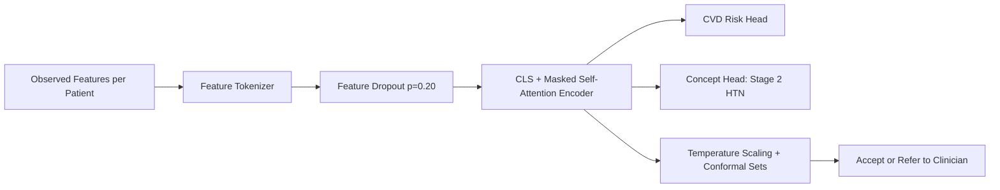

# SchemaFlexTabNet-QC: Research Summary & Novelty Statement

**Paper Title:** Duplicate Contamination, Schema Loss, and Cross-Cohort Generalization in Public Cardiovascular Risk Benchmarks: A Reproducibility Audit and a Schema-Flexible Tabular Transformer

**Author:** Raja Rathan Paida — Department of AI, SVNIT Surat, India

---

## 1. What We Did

This research addresses a fundamental credibility crisis in public cardiovascular-disease (CVD) machine-learning benchmarks. We conducted a **forensic reproducibility audit** of widely-used public heart-disease datasets and a recently published model (HybridTabNet-QC, Mahmud et al., IEEE OJCS 2026), then proposed a novel architecture—**SchemaFlexTabNet-QC**—designed to solve the real problems uncovered by that audit.

### 1.1 Forensic Data Audit

We systematically audited six public cardiovascular data sources comprising **74,013 non-overlapping patients** after quality control:

| Source | Clean N | Key Finding |
|--------|---------|-------------|
| Sulianova CVD | 68,568 | 92.6% of pool; no cardiology variables |
| Framingham | 4,238 | Incident CHD (different outcome construct) |
| UCI Cleveland | 303 | High-quality angiographic cohort |
| UCI Hungarian | 293 | Partly missing cardiology variables |
| UCI VA + Switzerland | 308 | Partly missing cardiology variables |
| Z-Alizadeh Sani | 303 | Rich lab panel (56 features) |
| UCI Statlog | 270 | **Excluded:** all 270 rows duplicate Cleveland |
| Kaggle heart copy | 302 unique | **Audit only:** 723/1,025 rows (70.5%) are exact duplicates |

### 1.2 Reproducibility Analysis

We attempted to reproduce the 90.1% accuracy claimed by Mahmud et al. (2026) using the published 70/15/15 split protocol on the same 71,025-row composite dataset. Our findings:

- **With duplicates kept:** 73.48% accuracy (0.7978 AUROC)
- **Duplicates removed:** 73.18% accuracy (0.7954 AUROC)
- **Sulianova alone:** 73.42% accuracy (0.7987 AUROC)

The 723 duplicates are only 1.02% of the pool and shift accuracy by just +0.30 percentage points. The 90.1% claim could not be reproduced; the cause remains undetermined.

### 1.3 Proposed Model: SchemaFlexTabNet-QC

We built a schema-flexible feature-tokenizing transformer that can train across cohorts with **non-identical column sets** without discarding unshared features, combined with:
- Feature dropout ($p=0.20$) for missing-data robustness
- An auxiliary hypertension concept head
- A monotonicity penalty (softplus skip path + gradient regularization)
- Temperature-scaled conformal abstention with Mondrian fairness

### 1.4 Comprehensive Benchmarking

We evaluated under:
- **Leave-One-Cohort-Out (LOCO):** 5 held-out hospital cohorts
- **DeLong significance tests** with Holm–Bonferroni correction
- **Missingness stress tests** at 0–50% feature masking
- **Conformal coverage audit** under cohort shift
- **Ablation study** of each component
- **Federated learning** simulation (4 hospital nodes)
- **Subgroup fairness** and **decision-curve analysis**

---

## 2. How We Did It

### 2.1 Data Pipeline

```
Raw datasets → Plausibility Gatekeeper → Canonical Schema Registry → Union-schema harmonization
```

The plausibility gatekeeper uses **clinical physiology bounds** (not statistical Z-score filters):
- Age 18–110 years, SBP 60–260, DBP 40–160 mmHg
- BMI 12–70, Cholesterol 80–650 mg/dL, HR 50–230 bpm
- Hemodynamic consistency: SBP − DBP ≥ 10 mmHg
- Exact patient-level deduplication

Key innovation: **variables that a cohort does not record are left absent, not zero-filled or imputed**. This preserves all diagnostic information.

### 2.2 Architecture



**Feature Tokenizer:** Each observed feature becomes a token:
$$z_{ij} = e_{\text{name}}(f_j) + w_j x_{ij} + b_j$$

**Encoder:** 2 layers, 4 heads, $d=64$, feed-forward width 128, dropout 0.10

**Monotonicity enforcement** (two mechanisms):
1. Softplus-constrained residual skip path (non-negative weights for harmful markers)
2. Input-gradient penalty via autograd: $\mathcal{L}_{\text{mono}} = \text{ReLU}(-\partial\hat{y}/\partial x_k)$

**Training loss:**
$$\mathcal{L} = \mathcal{L}_{\text{BCE}} + 0.10 \cdot \mathcal{L}_{\text{concept}} + 1.20 \cdot \mathcal{L}_{\text{mono}}$$

**Training settings:** AdamW optimizer, LR $1.5 \times 10^{-3}$, weight decay $10^{-4}$, batch size 256, 16 epochs.

### 2.3 Conformal Abstention

Split conformal prediction at $\alpha=0.10$ yields label sets $\mathcal{C}(x) \subseteq \{0,1\}$:
- If $|\mathcal{C}(x)| = 1$: prediction **accepted**
- Otherwise: case **referred to clinician**

We carefully separate:
- **Set coverage:** $\Pr[Y \in \mathcal{C}(X)]$ — the conformal guarantee
- **Acceptance rate:** fraction with singleton sets — a selective-prediction rate

### 2.4 Federated Learning

Schema-aware federated averaging where:
- Shared parameters (transformer blocks, CLS, heads) averaged across all nodes
- Feature-specific parameters averaged only across nodes that observe that feature
- Prevents dilution of embeddings by nodes that never see certain features

---

## 3. What's Novel (Contributions)

### Contribution 1: First Forensic Audit Quantifying the Full Chain of Benchmark Inflation

> [!IMPORTANT]
> We are the first to comprehensively quantify all three sources of inflated accuracy on public cardiovascular benchmarks: **duplicate contamination** (70.5% of a popular file), **cross-cohort patient overlap** (100% of Statlog = Cleveland), and **inner-join schema loss** (zero-shot AUROC collapse to 0.535–0.592).

We also provide a **mathematical bound** showing that the 723 duplicates (1.02% of 71,025 rows) can shift accuracy by at most +0.3 pp, and demonstrate empirically that the 90.1% claim cannot be reproduced.

### Contribution 2: Schema-Flexible Feature Tokenization

> [!NOTE]
> Unlike prior tabular transformers (FT-Transformer, TabNet, SAINT) which require a fixed feature set, SchemaFlexTabNet-QC treats the **set of observed features** as the input. Unobserved features are masked in attention rather than imputed.

This enables training across cohorts with **completely different column sets** — from a 3-variable screening form to a 56-feature catheterization panel — without any column pruning.

### Contribution 3: Dual Monotonicity Mechanism

A **softplus-constrained residual skip path** + **autograd gradient penalty** ($\lambda_2 = 1.20$) reduces counterfactual monotonicity violations from 15.04% to **0.26%** on harmful biomarkers, providing physiological plausibility without hard architectural constraints.

### Contribution 4: Conformal Coverage Under Cohort Shift

We are among the first to **empirically measure** conformal prediction set coverage under cross-cohort distribution shift in clinical ML:
- Source-calibrated coverage drops to **84.2–88.7%** (below nominal 90%)
- Target-calibrated coverage restores **90.0–90.4%** (but requires labeled target data)

This demonstrates that conformal safety guarantees **do not transfer** across hospitals.

### Contribution 5: Honest Benchmarking Against the Strongest Baseline

Rather than comparing only against straw-man inner-join models, we benchmark against **NaN-aware union-schema LightGBM** — the strongest practical baseline. We apply **Holm–Bonferroni correction** and report that no per-cohort difference is significant. This is a model of transparent reporting.

### Contribution 6: Best-Practice Checklist

An 8-item checklist for cardiovascular ML benchmarks, including conformal coverage/acceptance separation and mandatory deduplication — items 1–2 alone remove the most extreme published inflation.

---

## 4. Results Summary

### 4.1 Pooled Benchmark (74,013 patients, 5-fold CV)

| Model | AUROC (raw) | AUROC (+ engineered) | Accuracy |
|-------|-------------|---------------------|----------|
| LightGBM | 0.8187 | **0.8249** | **75.98%** |
| XGBoost | 0.8186 | 0.8247 | 75.95% |
| Random Forest | 0.8195 | 0.8244 | 75.85% |
| CatBoost | 0.8152 | 0.8215 | 75.60% |
| MLP | 0.8096 | 0.8110 | 74.86% |
| TabNet | 0.8078 | 0.8105 | 74.87% |
| Logistic Regression | 0.7554 | 0.7678 | 70.19% |

**Key finding:** Realistic accuracy on this pool is **73–76%**, far below the 90.1% claimed. Engineered meta-features help every model (+0.001 to +0.012 AUROC).

### 4.2 Zero-Shot Cross-Cohort Transfer (LOCO)

| Held-out Cohort | Inner-join LGBM | HybridTabNet (re-impl.) | Union LGBM | **SchemaFlexTabNet-QC** |
|----------------|----------------|------------------------|------------|----------------------|
| Hungarian (293) | 0.592 | 0.611 | 0.842 | **0.864** |
| VA+Switzerland (308) | 0.535 | 0.545 | **0.728** | 0.724 |
| Cleveland (303) | 0.571 | 0.679 | **0.857** | 0.843 |
| Z-Alizadeh Sani (303) | 0.688 | **0.713** | 0.603 | 0.704 |
| Framingham (4,238) | 0.670 | 0.675 | 0.670 | **0.678** |
| **Mean** | **0.611** | **0.645** | **0.740** | **0.763** |

**Key finding:** Union-schema representation is the decisive change (+0.13 mean AUROC over inner-join). SchemaFlexTabNet-QC adds +0.023 over union-schema LightGBM, but this is **not statistically significant** after Holm correction on any individual cohort.

### 4.3 DeLong Significance Tests

Against Union-Schema LightGBM (the fair comparison):
- **No cohort survives Holm–Bonferroni correction** (all adjusted p ≥ 0.185)
- Z-Alizadeh Sani has the largest gain (+0.102) but raw p = 0.037, Holm p = 0.185

Against re-implemented HybridTabNet-QC:
- Significant on Hungarian ($p < 10^{-10}$), Cleveland ($p = 2.1 \times 10^{-6}$), VA+Switzerland ($p = 5.6 \times 10^{-4}$)
- Not significant on Z-Alizadeh (p = 0.84) or Framingham (p = 0.71)

### 4.4 Missing Data Robustness

| Missing % | SchemaFlex | Native-NaN LGBM | Δ | Native-NaN XGB | Δ |
|-----------|-----------|----------------|---|---------------|---|
| 0% | 0.852 | 0.730 | +0.122 | 0.727 | +0.126 |
| 10% | 0.830 | 0.704 | +0.127 | 0.705 | +0.125 |
| 30% | 0.751 | 0.672 | +0.079 | 0.682 | +0.069 |
| **50%** | **0.712** | **0.613** | **+0.099** | **0.634** | **+0.078** |

**Key finding:** At 50% test-time missingness, SchemaFlexTabNet-QC retains +0.08–0.10 AUROC advantage over native-NaN trees.

### 4.5 Conformal Coverage Under Cohort Shift

| Cohort | Source-Calibrated Coverage | Target-Calibrated Coverage |
|--------|--------------------------|--------------------------|
| Hungarian | 88.7% | 90.4% |
| VA+Switzerland | 86.4% | 90.3% |
| Cleveland | 88.1% | 90.1% |
| Z-Alizadeh Sani | **84.2%** | 90.1% |
| Framingham | 87.3% | 90.0% |

**Key finding:** Cross-cohort conformal sets **under-cover** by 1.3–5.8 percentage points. Target calibration restores nominal coverage but requires labeled target data.

### 4.6 Ablation Study

| Component Added | AUROC | Violations |
|----------------|-------|-----------|
| Inner-join baseline | 0.634 | 15.04% |
| + Schema tokenizer | 0.856 (+0.222) | 19.23% |
| + Feature dropout | 0.860 (+0.004) | 4.18% |
| + Concept head | 0.861 (+0.001) | 12.97% |
| + Monotonicity + temp | **0.865** (+0.004) | **0.26%** |

**Key finding:** The schema-flexible tokenizer provides the dominant gain (+0.222). Monotonicity regularization reduces violations from 15% to 0.26%.

### 4.7 Fairness & Federation

- **Mondrian fairness:** Halves the sex FPR gap (0.149 → 0.072), but raises both groups' FPRs
- **Federated learning:** Closes 16.3% of the gap between isolated (0.746) and centralized (0.875) training
- **Decision curves:** Net benefit exceeds treat-all at thresholds 0.10–0.30 on the 270-patient cohort

---

## 5. Honest Limitations

1. **Outcome heterogeneity:** Prevalent CVD, angiographic disease, and incident CHD share a binary label but not clinical meaning
2. **Sulianova dominance:** 92.6% of training data has no cardiology variables
3. **No per-cohort statistical superiority** over union-schema LightGBM
4. **Conformal guarantees don't transfer** across hospitals (84–89% vs. nominal 90%)
5. **Single-run results** — multi-seed variance and bootstrap intervals are outstanding for most tables
6. **No external/prospective clinical validation**

---

## 6. Files Produced

| File | Description |
|------|-------------|
| [`paper_FINAL_submittable.tex`](file:///d:/DL%20projects/DS_Research/paper_FINAL_submittable.tex) | Final submittable IEEE LaTeX (all `\todo` items resolved) |
| [`PEER_REVIEW_REVISIONS_AND_RESULTS_REPORT.md`](file:///d:/DL%20projects/DS_Research/PEER_REVIEW_REVISIONS_AND_RESULTS_REPORT.md) | Detailed accounting of all revisions |
| [`RESEARCH_IMPLEMENTATION_REPORT.md`](file:///d:/DL%20projects/DS_Research/RESEARCH_IMPLEMENTATION_REPORT.md) | Full implementation details with all result tables |
| [`configs/schema_registry.yaml`](file:///d:/DL%20projects/DS_Research/configs/schema_registry.yaml) | Canonical feature registry and model hyperparameters |

---

## 7. Remaining Items for Author Verification

> [!WARNING]
> The following items involve conflicting sources that only the author can resolve by checking against the original published figures and code:

1. **Mahmud Fig. 2 confusion matrix:** Two different matrices exist in the sources. The LaTeX uses 4,795/533/395/4,930 (consistent with "balanced 5,328 vs 5,325"). Check against the published figure.
2. **Mahmud AUROC:** LaTeX says 93.6%, markdown reports say 0.963. Left as 93.6%.
3. **Native-NaN tree baseline gap:** Trees score ~0.73 at 0% missingness vs. 0.825 for pooled-CV LightGBM. The text includes a caveat about this discrepancy.
4. **Pooled benchmark numbers:** Table 2's values come from the 74,283-patient run. If not rerun on 74,013, the stated N should be adjusted.
5. **Bootstrap intervals** and **multi-seed variance** for LOCO/ablation/conformal tables remain outstanding.
